# Kisan Sathi — Entity Relationship Diagram

Generated from the schema in `server/db.js` plus the tables that routes create on first use
(`server/routes/auth.js` → `password_resets`, `server/routes/feed.js` → `posts`, `post_likes`,
`post_comments`, `server/routes/beneficiaries.js` → `beneficiaries`).

- Solid lines (`--`) = foreign keys declared in SQL (`FOREIGN KEY ... REFERENCES`).
- Dotted lines (`..`) = logical links the app maintains in code, with no SQL constraint.
- `market_prices` and `weather` are standalone reference tables.

```mermaid
erDiagram
    users {
        int id PK
        text name
        text role "super_admin | farmer | expert"
        text phone UK
        text email UK
        text password_hash
        text language "default en"
        text bio
        text address
        text avatar
        int show_contact
        int active
        int ward "1-11"
        text province
        text district
        text palika
        text gender
        text created_at
    }
    experts {
        int expert_id PK, FK
        text specialization
        text bio
        int available
        int verified
        text proof_image
    }
    farms {
        text farm_id PK
        int farmer_id FK
        text name
        text location
        real latitude
        real longitude
        real size
        text size_unit "default ropani"
        text soil_type
        text created_at
    }
    crops {
        int crop_id PK
        text farm_id FK
        int farmer_id FK
        text name
        text category "tree | plant | vegetable | animal"
        text planted_date
        int plant_count
        text growth_stage
        text watering_schedule
        text fertilizer_used
        text disease_history
        text growth_status
        text harvest_date
        text notes
        text created_at
    }
    qr_codes {
        int qr_id PK
        text code UK
        text farm_id FK
        int crop_id FK "nullable"
        text created_at
    }
    updates {
        int update_id PK
        int crop_id FK
        int farmer_id FK
        text details
        text images
        text created_at
    }
    disease_detections {
        int id PK
        int farmer_id FK
        int crop_id FK "nullable"
        text image
        text disease_name
        text symptoms
        text cause
        text treatment
        text fertilizer
        text prevention
        real confidence
        text created_at
    }
    sales {
        int id PK
        int farmer_id FK
        int crop_id FK "nullable"
        text product
        text category
        real quantity
        text unit
        real price_per_unit
        real total_amount
        text buyer
        text sale_date
        text notes
        text created_at
    }
    expenses {
        int id PK
        int farmer_id FK
        int crop_id FK "nullable"
        text category
        text description
        int workers
        real quantity
        text unit
        real rate
        real amount
        text expense_date
        text notes
        text created_at
    }
    products {
        int id PK
        int seller_id FK
        text title
        text category
        text description
        real price
        text unit
        real quantity
        text location
        text image
        text contact
        text status "available ..."
        text created_at
    }
    orders {
        int id PK
        int product_id FK
        int buyer_id FK
        int seller_id FK
        real quantity
        real total
        text message
        text status "pending ..."
        text created_at
    }
    messages {
        int id PK
        int farmer_id FK
        int expert_id FK "nullable"
        text sender_role
        text text
        text image
        text created_at
    }
    notifications {
        int id PK
        int user_id FK "null = broadcast"
        text type
        text title
        text message
        text link
        int is_read
        text created_at
    }
    subsidies {
        int id PK
        int farmer_id FK
        text type
        text title
        text details
        real amount
        text status "pending | approved | rejected | distributed"
        text admin_note
        text created_at
        text decided_at
    }
    beneficiaries {
        int id PK
        text name
        int age
        int ward
        text phone
        text address
        text subsidy_type
        real amount
        text given_date
        text status
        text remarks
        int source_subsidy_id "logical FK"
        text created_at
    }
    posts {
        int id PK
        int user_id "logical FK"
        text content
        text image
        text images "JSON array"
        int pinned
        text pinned_at
        text created_at
    }
    post_likes {
        int post_id PK "logical FK"
        int user_id PK "logical FK"
        text created_at
    }
    post_comments {
        int id PK
        int post_id "logical FK"
        int user_id "logical FK"
        text content
        text created_at
    }
    password_resets {
        text token PK
        int user_id "logical FK"
        text code "OTP"
        int attempts
        text expires_at
        int used
        text created_at
    }
    market_prices {
        int id PK
        text crop_name
        text category
        text market_name
        real price
        text unit
        text trend
        text date
    }
    weather {
        int id PK
        text location
        real temperature
        real humidity
        text rain_prediction
        text condition
        text alert
        text date
    }

    users ||--o| experts : "expert profile"
    users ||--o{ farms : owns
    farms ||--o{ crops : grows
    users ||--o{ crops : manages
    farms ||--o{ qr_codes : "labelled by"
    crops |o--o{ qr_codes : "labelled by"
    crops ||--o{ updates : "has"
    users ||--o{ updates : posts
    users ||--o{ disease_detections : scans
    crops |o--o{ disease_detections : "diagnosed in"
    users ||--o{ sales : records
    crops |o--o{ sales : "sold as"
    users ||--o{ expenses : records
    crops |o--o{ expenses : "spent on"
    users ||--o{ products : sells
    products ||--o{ orders : "ordered in"
    users ||--o{ orders : "buys"
    users ||--o{ orders : "receives (seller)"
    users ||--o{ messages : "farmer thread"
    users |o--o{ messages : "expert replies"
    users |o--o{ notifications : receives
    users ||--o{ subsidies : applies
    subsidies |o..o{ beneficiaries : "copied to registry"
    users ||..o{ posts : writes
    posts ||..o{ post_likes : "liked in"
    users ||..o{ post_likes : likes
    posts ||..o{ post_comments : "has"
    users ||..o{ post_comments : comments
    users ||..o{ password_resets : requests
```

